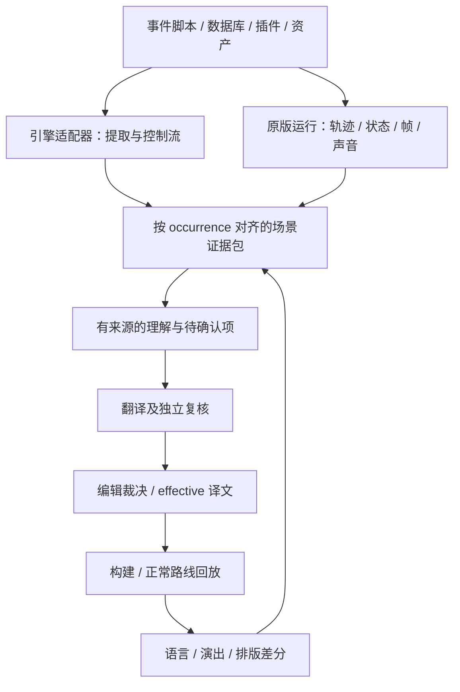

# 让 AI 读懂 2D RPG：以事件取证驱动翻译

建议把“端到端”定义为：**原始事件与资产 → 可回溯的场景证据 → 翻译/润色 → 实装 → 运行验收**。第一版先让 agent 能可靠地回答“这句话发生时，谁在哪里、刚做了什么、对谁说、玩家知道什么”，再决定是否需要自动玩完整游戏。

这是下一项目的设计建议。本仓库的 PPSSPP 驾驶、文字账本、裁决 UI 和字声差异调查提供了原型经验；这里描述的 RPG 事件 IR、取证接口和评测并未在本仓库实现。

## 1. 比 VN 多出的信息不是“插图”，而是事件状态

“……もういい。”可以是“……够了。”“……算了。”或“……已经好了。”同一句之前若是角色停止敲门、转身走开、把修好的东西放回，译法依据会完全不同。但仅看到“向下走两格”，也不能直接推导“伤心离开”。动作与心理解释需要分层。

RPG Maker MZ 中，同一地图事件有多个条件页，多个页符合时选最高 ID 页；页删除还会影响后续页 ID。因此 `(map,event,page,command)` 是一个版本内定位，并非跨版本永远稳定的身份。[官方事件页说明](https://rpgmakerofficial.com/product/MZ_help-en/01_09_03.html)

移动路线可以改变朝向、图像、透明度、音效，并可能等待或跳过不能完成的移动。静态“发出了移动命令”与运行时“角色已到目的地”要区分。[官方移动路线说明](https://rpgmakerofficial.com/product/MZ_help-en/01_10_06_01.html)

WOLF 也有条件启动、并行公共事件及调用参数；并行事件在条件变化时可能中断。不能直接套用另一个引擎的调度规则。[WOLF 公共事件设置](https://silversecond.com/WolfRPGEditor/Help/02commonev.html)、[调用与参数](https://silversecond.com/WolfRPGEditor/Help/04ev_common.html)

这些机制意味着：文件顺序、事件编号、画面出现顺序和故事时间都可能不同。

## 2. 三层表示：机器事实、视听证据、叙事解释



第一层用程序抽事实，第二层保留看得见/听得到的证据，第三层才让模型写解释。每条解释关联证据 ID，并标 observed/inferred/unknown。不要把一份 LLM 生成的“剧情梗概”当作原始真相喂给所有下游模型。

每句应该关联以下信息：

| 类别 | 内容 |
|---|---|
| 静态定位 | source revision、text ID、地图/事件/页/命令或公共事件、调用栈 |
| 执行定位 | run ID、occurrence ID、解释器实例、游戏帧、单调时间、当前等待状态 |
| 活跃条件 | 页条件、相关 switch/variable/self-switch、队伍/物品/任务条件；来源可查 |
| 场景对象 | event instance → 实体候选、图像/脸图、名字窗口、坐标/朝向/透明度、替身与换装关系 |
| 地图语义 | 原图/tileset、视口、通行区域、门/出口/道具候选；语义标注带证据 |
| 演出 | 移动开始/完成、镜头滚动、图片/动画、气泡、屏幕色调/闪烁、音效/音乐/静默 |
| 语言 | 原始文本模板、插值后的显示串、前后对白、选择肢及分支、实际音频 |
| 知识 | 角色知道什么、玩家已见什么、译者才知道什么；路线与揭示时点 |

“event 名叫 Mom”“精灵像女性”只能是身份线索。公共图块、相同脸图、换装、变身、假扮都可能使自动归人出错。实体表支持多对多和临时身份，匿名说话人先保留匿名。

## 3. 静态适配器：覆盖高价值指令，未知部分有出口

按确切引擎版本实现 parser/exporter，保留原始事件结构与未理解字段。建议能力清单包含：

1. 文本、选择、变量插值、数据库名称、提示/任务/UI 与图片字。
2. 条件、循环、标签/跳转、地图传送、公共事件调用和返回。
3. 开关/变量/自身开关、队伍/物品变化、事件页激活。
4. 移动路线、等待、朝向/图像、镜头/图片/动画/气泡、音频。
5. 插件指令、脚本块和自定义公共事件包装。

先为当前作品真正用到的指令建立语义，不必先完整实现所有引擎。每类记录 supported/opaque/observed_only；例如未知插件可能改任意状态，就发出“需要运行取证”，不能当 no-op 继续推导。

对目标对白做反向依赖切片：哪些状态决定它能否出现，哪些动作决定它的指代、主语和语气，哪些公共事件改变它的显示值。大多数无关战斗数字不需入 prompt；决定“已经/还没”“你们/你”的状态必须入包。

输出的是带条件的控制流和事件关系，不要求全局 DAG。剧情循环、NPC 重复对话和路线回溯应保留；循环只在阅读摘要层做可解释压缩。

## 4. 动态取证：让游戏本身回答静态分析的疑问

若运行环境允许，优先在测试副本的事件解释器、消息窗口和状态写入处增加只读日志钩子；另保存脚本/插件清单 hash。具体钩子依版本确认：MV/MZ 类项目可调查其脚本运行时，旧版 RPG Maker 与 WOLF 不能预设相同的 JS 接口；不可注入时用调试器、合法导出/日志、正常录屏和存档组合。

每次显示文本时记录模板、替换结果、源命令指针、调用栈、状态摘要和截图。每次动作记录命令下发与实际完成；首次遇到场景取快照，之后用 delta 避免逐帧重复全量状态。

**保留并发的时间关系。**主事件、并行事件、公共事件和移动路线可能各有进度。轨迹保存 start/end、wait/continue 和必要的 happens-before 边；不要把所有日志按文本行顺序拼成“先 A 后 B”。对话出字时角色可能还在走，文案长度也可能改变并行演出重叠，需要在译版重新观察。

抓帧以事件触发为主：对白出现前后、移动开始与结束、图像/朝向/透明度变化、关键 SE、传送、选择、黑场。普通场景给 4–8 帧 contact sheet 作为初始预算；含时序意义的动作保留短视频/音频，不让单张截图承担全过程证明。

测试入口分两类并明确标签：

- **真实路径**：从正常存档按可记录输入走到场景，支持可达性结论。
- **夹具入口**：预置状态/跳到指定事件，支持局部翻译和渲染复验，不能证明自然流程可达。

存档、输入序列、引擎版本、插件顺序、随机种子（能控制时）和状态摘要一起存。随机或时序不稳定处允许重复采样，不谎称完全可复现。

## 5. Scene packet：agent 真正要读的材料

推荐顺序：当前对白单元 → 本次路径和角色知识 → 相关前因 → 地图/角色 contact sheet → 带时间的事件摘要 → 原始证据链接 → 同族译法与规则 → 不确定项。

不要每次发送整张高分辨率地图和数百页日志。先提供全景缩图与关键区域原尺寸裁剪，坐标使用稳定的地图坐标，标明视口；放大图用 nearest-neighbor 等能保留像素形状的方式。图中字幕 OCR 不代替脚本原文。

对句子 `それを、あそこへ。`，包里应能找到说话者、受话者、指向动作/道具候选和位置证据。若只能观察到角色转身，仍无法确认“那边”是哪个物件，就保留“把那个放到那边去”，登记歧义。**更完整的上下文用于选准词义与语气，不等于在译文里写出动作说明。**

字声不同、屏幕字与台词矛盾、反讽等情况保留多层内容，不自动“修成一致”。本项目 [e2f 记录](../ops/e2f-voice-text-divergence-2026-09-21.md)就是实例：十行字幕和配音分别承载叙事内容，最终用经编辑裁定的双行方案呈现。它不能直接推广为“所有游戏都补双字幕”。

## 6. 给 agent 工具，而不是让它盲猜完整游戏

下面是建议的能力接口，并非本仓库已有 API：

```text
get_text(text_id, source_revision)
get_occurrences(text_id, route_filter)
get_event_slice(occurrence_id, include_dependencies=true)
get_state(occurrence_id, relevant_keys)
get_scene_assets(occurrence_id)
get_evidence(evidence_id)                 # 原图/声音/日志片段
search_family(text_id, relation_type)
request_capture(checkpoint_id, purpose)  # 进入待执行取证队列
submit_candidate(text_id, baseline_hash, target, evidence_refs, open_questions)
```

需要取证的条件示例：说话人未定、插件效果 opaque、两条路径改变受话对象、指示代词依赖画面、语音与字幕显著不符、状态推导与运行截图冲突。先解决影响取义的最小未知，不要求重新通关。

如果同一个源位置在两种状态下确实需要不同译文：先试不损失含义的共同译法；不可兼容时登记条件译文，并由引擎导出器明确绑定条件。不能只在翻译数据库里存两行、却让导出器随机取最后一行。

读者理解测试仍有价值，但输入应与玩家可见信息一致。出题端依据原版脚本/视听证据建立答案；答题端只看中文版对应证据，禁止读答案。问题包含“谁离开了、这句对谁说、道具怎么换手、此时身份是否揭晓”，并允许证据不足。

## 7. 控制状态爆炸与取证成本

按影响译文的状态划分等价类：若一组开关变化不影响该句的可见身份、受话对象、前因或文本插值，可以共享一个 context。**等价是当前模型下的假设**；自定义脚本或并行事件可能推翻它，需保留未知边并抽样验证。

优先覆盖：主线关键场景、路线分歧、任务前后 NPC 页、物品/队伍条件、结局、会改变称呼或指代的状态。不要承诺穷举所有开关组合。每条覆盖分为 extracted / statically_contextualized / observed / translated / reviewed / runtime_checked，分别给分母。

资产说明按 asset hash 缓存；但同一图像在不同上下文的叙事含义不能只按图像缓存。scene packet 缓存键至少包括源版本、相关状态/路径、资产、摘要与 prompt 版本。原文/资产变更触发关联译文重新评估。

先跑“脚本＋事件摘要”，仅对证据缺口升级到图片、短视频、额外回放。一次独立复核足够的问题不继续无限召集模型；新增通道按独有真贡献和编辑成本决定。

## 8. 试点如何证明这套方法值得继续

选 20–40 个场景作为起步规模，覆盖纯对白、走位交接、并行演出、匿名/伪装、变量插值、可变任务页及动态插件；这个数量是工程建议，不是统计学保证。

在同一源版本和相同模型/调用条件下做对照：

| 组 | 输入 | 检验的问题 |
|---|---|---|
| A | 原文＋附近对白 | 纯文本基线 |
| B | A＋静态事件切片/相关状态 | 结构化演出上下文是否足够 |
| C | B＋实际轨迹＋关键帧/短音视频 | 多模态取证是否解决剩余歧义 |

分组输入不共享模型生成答案，缓存和检索权限相同或明确记录差异；资源允许时多次生成以观察方差。编辑盲评错误类型，重点看指代/施受/时相/知识泄露、演出被改平，以及没有依据的“合理解释”。另外测每百行裁决分钟数、每场景取证成本、未解决率。

可播种少量已知缺陷测试检测器：交换受话对象、删等待、错绑事件页、去掉关键帧、提前实名；这些合成项单列，不与自然错误率混算。用确实无需画面即可翻译的场景作负对照，检查多模态输入是否只是增加了臆测。

当 B 已解决多数问题，C 只针对剩余高风险处；如果 C 没降低错误或编辑负担，就修改取证/对齐方式，不把“看过视频”当质量指标。

## 9. 我建议的落地顺序

第一步建立一个事件导出器、原版启动/存档入口与 5 个手工 packet，验证 packet 真能改变误译判断。第二步接运行日志与事件触发截图，自动对齐 text occurrence，做 A/B/C 小试点。第三步把有效字段接入已有的翻译、裁决、召回工作台，并对译版做相同入口的运行差分。

最后才扩自动探索、更多引擎和复杂语义状态模拟。**最优先的新工装是“原文＋事件＋画面＋译文”的场景检查器和取证回放器**；它既服务 agent，也让人类编辑更快查证，通常比先造自主通关 agent 更容易形成可用闭环。
